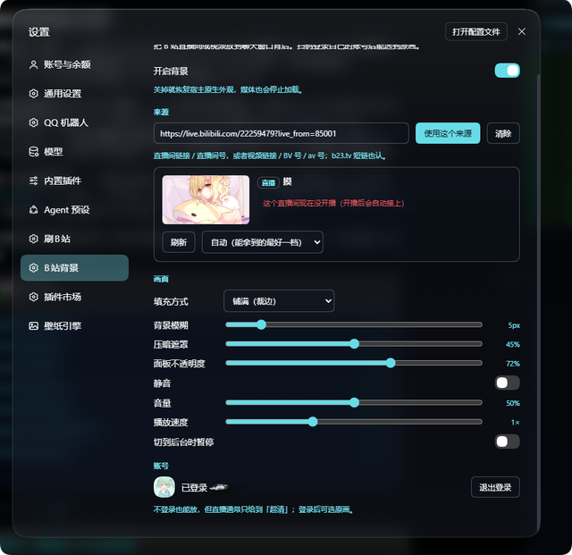
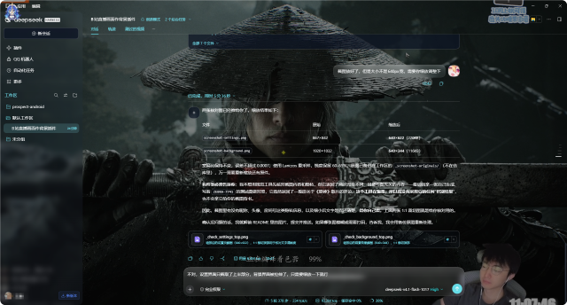

# dsh-bili-wallpaper

**English** · [简体中文](README.md)

Play a **Bilibili live room** or **any video** as the background of the DeepSeek Harness Web GUI. Scan a QR code to sign in with your own account → paste a live/video URL → pick a quality tier, and the picture plays behind the chat window.

> A DeepSeek Harness plugin that plays a Bilibili live room or video behind the chat UI. Scan-login with your own account, paste a live/video link, pick the quality tier — with adjustable blur, scrim and panel opacity.

<p align="center">
  
</p>

---

## What it does

| Capability | Description |
| --- | --- |
| **Live background** | Paste a live-room URL or room id (`https://live.bilibili.com/6` / `6`); the live picture fills the area behind the chat |
| **Video background** | Paste a video URL, `BV` id or `av` id; multi-part videos are supported |
| **Scan login** | The QR code is rendered inside the settings page — scan it with the Bilibili app. Signing in unlocks the original quality tier for live streams |
| **Quality picker** | "Auto" picks the best tier available; you can also pin 原画 (original) / 蓝光 (Blu-ray) / 超清 (Ultra HD)… |
| **Picture controls** | Cover / contain, background blur, darkening scrim, panel opacity, mute / volume / playback rate |
| **Battery friendly** | Pauses automatically when the window is hidden (can be turned off) |
| **Translucent UI** | Panels, sidebar and bubbles turn into glass surfaces that let the picture through, while text stays readable |
| **Self-healing live** | When the stream URL expires, or the host goes offline and comes back, the plugin re-resolves automatically |
| **End-of-video action** | When a video ends: play next part (default) / loop / stop on the last frame / turn the background off |
| **Part switching** | Pick any part of a multi-part recording, plus previous / next buttons |
| **Seek bar** | Drag to jump to any point; shows current position / total duration live |
| **Resume** | Reopening the same video (same part) continues from where you left off |

### Interface

The settings page lives at **Settings → B站背景**. It has five blocks: enable / source / quality / picture / account.

<p align="center">
  
</p>
<p align="center">
  
</p>

---

## Installation

[](https://www.npmjs.com/package/dsh-bili-wallpaper)
[](LICENSE)

### Option 1: from npm (easiest, recommended)

```powershell
dsh plugin --profile web add dsh-bili-wallpaper
```

The package lives at [npmjs.com/package/dsh-bili-wallpaper](https://www.npmjs.com/package/dsh-bili-wallpaper). Runtime dependencies are vendored into the package, so it **does not** pull any further npm packages.

> On the desktop build, replace `--profile web` with `--profile desktop` (the desktop default profile is called `desktop`).

### Option 2: from GitHub

```powershell
# One command, straight from the repo
dsh plugin --profile web add github:st21a1/dsh-bili-wallpaper

# Or clone first
git clone https://github.com/st21a1/dsh-bili-wallpaper.git
cd dsh-bili-wallpaper
dsh plugin --profile web add .
```

### Option 3: from a local directory

```powershell
dsh plugin --profile web add "C:\path\to\dsh-bili-wallpaper"
```

### Option 4: let the Agent install it

Give the Agent the repo URL or package name and ask it to install the plugin into the current profile (it calls `plugin_manager install_bundle`).

### After installing

1. **Restart Harness** — the Host half (`index.js`) is only loaded at startup
2. Open **Settings → B站背景**
3. Paste a live or video URL and press "use this source"
4. Press "scan to sign in" if you want the original quality tier

> Only changing `client.js` (the UI half) does not need a restart — a page refresh is enough (via client HMR).

### Uninstall

```powershell
dsh plugin --profile web remove dsh-bili-wallpaper
```

Configuration and credentials live in `$DSH_HOME/bili-wallpaper/`. Uninstalling does not delete them; remove the directory manually if you want them gone.

---

## Supported profiles

| Profile | Supported | Notes |
| --- | --- | --- |
| `desktop` | ✅ Full | Default profile of the desktop build; development and verification happen here |
| `web` | ✅ Full | Started with `dsh web`, accessed through a browser; the background layer is plain DOM and does not depend on Electron |
| `tui` / headless | ❌ Pointless | No Web GUI, so there is nothing to draw on |

The plugin declares a hard dependency on `webServer`: profiles without an HTTP server never load this row — it neither errors nor slows startup.

---

## Permissions and data

**It only reads your own data and only talks to Bilibili.**

| Item | Detail |
| --- | --- |
| Network | Only `api.bilibili.com`, `api.live.bilibili.com`, `passport.bilibili.com` (login) and Bilibili CDNs for media |
| Credentials | After scanning, `SESSDATA` / `bili_jct` / `DedeUserID` / `buvid3` are taken from `Set-Cookie` and stored in `$DSH_HOME/bili-wallpaper/bili_credential.json` (attempts `chmod 600`) |
| Local config | `$DSH_HOME/bili-wallpaper/config.json` |
| No uploads | Credentials, watch history and all other data stay local; there is no telemetry |
| HTTP routes | Same-origin `127.0.0.1` only, with signature checks |
| Media proxy | Only allows a whitelist of Bilibili CDN hosts — **not** an open proxy |
| Filesystem | Reads and writes only the two files above; never touches your workspace |
| Subprocesses | None (no ffmpeg / python / external binaries) |

### Why a Host-side proxy is mandatory

It is not a design choice but a requirement:

1. **Hotlink protection**: the video CDN returns `403` without `Referer: https://www.bilibili.com/` (measured).
2. **HLS playlist rewriting**: segment URLs inside an m3u8 are relative; a browser cannot fetch them cross-origin, nor attach a Referer.
3. **Signing**: every proxy URL carries `HMAC-SHA256(in-process random key, target URL)`, which expires on restart.
4. **Live URL expiry**: the `expires` in live URLs is typically tens of minutes; when hls.js reports a fatal error the client asks the Host to re-resolve.

---

## Compatibility

| Item | Version |
| --- | --- |
| DeepSeek Harness | `^0.2.0-rc.1` (developed and verified on **0.2.1-rc.3**) |
| Node.js | `>=22.12.0` |
| Platform | Windows / macOS / Linux (verified on Windows 11 + DSH Desktop) |
| Browser | Any modern browser with `MediaSource Extensions` (Chrome / Edge / Firefox / Safari 14+) |
| With other plugins | Overlaps with `dsh-plugin-wallpaper-engine`: when both are active the plugin warns and suggests keeping only one |
| Needs a Web GUI | Yes (`desktop` / `web` profiles) |

### Dependencies

Runtime dependencies are vendored, so **no npm install happens at runtime**:

- [`hls.js`](https://github.com/video-dev/hls.js) 1.6.13 (light build) — Apache-2.0
- [`qrcode`](https://github.com/soldair/node-qrcode) 1.5.4 — MIT
- [`dijkstrajs`](https://github.com/tcort/dijkstrajs) 1.0.3 — MIT

---

## Known limitations

- Live streams use **HLS** only (ts / fmp4). Rooms that only offer FLV get an explicit "not supported" message instead of a black screen.
- Video uses `durl` (a whole MP4); videos split by Bilibili into several segments **play only the first segment**, and the page says so.
- Resume positions are stored per "video + part"; finishing a part clears that part's position, otherwise the next open would resume at the very end.
- Live streams have no seek bar (they are real-time); part switching and the seek bar only appear for videos.
- Signed out, videos usually cap at 720P and live streams at 超清; 原画 needs a signed-in account.
- Live prefers **ts**: the AAC track is muxed into the segments, so audio and video stay in sync naturally (measured `Audio: aac (LC), 48000 Hz, stereo`).
- Browsers may block autoplay with sound → the plugin starts muted, shows a hint in the page, and restores sound on one click.

---

## Development

```powershell
node build.mjs                         # inline hls.js into client.js (required after editing client.src.js)
node test/test-client.mjs              # run registration in a fake window; checks the slot and hls cleanup
node test/test-hls-inline.mjs          # confirm the inlined hls.js really attaches to globalThis.Hls
node test/test-audio.mjs               # audio regression: config migration / volume fallback / live must pick ts
node test/test-host.mjs                # boot the Host with a fake ctx and hit the real Bilibili API and proxy
node test/test-absolute-media-url.mjs  # media URL must be absolute http://, cross-origin readable, signature enforced
node test/test-playback.mjs            # parts / progress round-trip / key isolation (against the real API)
node test/test-next-part.mjs           # one `ended` swaps the source exactly once (no extra rebuild)
node test/test-seek-ui.mjs             # seek-bar state machine: no snap-back on release, reset on part switch
node test/test-docs-bilingual.mjs      # bilingual docs: encoding, cross-links, matching sections and versions
```

`test/test-host.mjs` uses a temporary `DSH_HOME` and never touches your real config or credentials.
See [`test/`](test/) for the complete list — 17 suites in total.

### Layout

```
index.js            Host: routes, scan login, source resolution, media proxy, config storage
client.src.js       Browser half source (contains the /*__HLS_INLINE__*/ placeholder)
client.js           Build output (generated by build.mjs — do not edit)
build.mjs           node build.mjs → inlines hls.js into client.js
cordis.patch.yml    Bundle patch (a single Host row)
locale/{zh,en}.json Name / description shown in the plugin manager
icon.svg            Icon
vendor/             hls.js, qrcode, dijkstrajs (all permissive licenses)
test/               Offline self-tests
```

### Architecture

```
Browser                         Host (Node)                       Bilibili
  │  settings page / background     │                               │
  ├── GET  /api/bili-wallpaper/state ─────► config + account snapshot
  ├── POST /api/bili-wallpaper/config ────► write config.json
  ├── POST /api/bili-wallpaper/login/start ─► passport QR code ──────►
  ├── POST /api/bili-wallpaper/login/poll ──► poll + capture SESSDATA
  ├── GET  /api/bili-wallpaper/resolve ────► resolve source ──► getRoomPlayInfo / playurl
  └── GET  /api/bili-wallpaper/proxy?u=… ──► fetch with Referer ─────►
```

Key implementation notes:

- The background layer is a plain element attached to `body` (`z-index: -2`), with a scrim at `z-index: -1` — **it is not inside the React tree**, so navigation never drops it.
- Translucency comes from overriding host-declared tokens (`--dsw-alias-bg-base` / `--dsw-alias-bg-layer-*` / `--dsw-specific-sidebar-fill`), never from touching other plugins' private class names. Selectors are stacked to `(0,2,1)` and use `!important` to outrank later stylesheets.
- `hls.js` is inlined at build time; at runtime it temporarily attaches `globalThis.Hls` and removes it immediately, so it never fights other plugins over globals.

### Facing "-351 受到神秘力量干扰" (risk control)

`-351` is a Bilibili risk-control code — **not a wrong URL and not an expired login**. The plugin does three things about it:

- **Signed-in requests omit `buvid3`**: measured, `SESSDATA + buvid3` together is treated as "same account, unfamiliar device fingerprint" and `playurl` returns -351 immediately; dropping `buvid3` from the same request yields `code=0`. Signed-in requests therefore only carry `SESSDATA` / `bili_jct` / `DedeUserID`.
- **Anonymous requests include `buvid3`**: when signed out it helps (obtained from `finger/spi`, cached in-process).
- **Automatic backoff**: `-351` / `-352` / `-412` / `-509` are retried three times at 0.6s → 1.6s → 3.2s; network hiccups are retried too.

If it still fails, work through this order:

1. **Press "sign out" in the settings page and retry** — when an account is flagged, anonymous access often works (the fastest fix)
2. Scan again to obtain a fresh set of credentials
3. Wait 5–10 minutes (risk-control windows are usually minutes to a quarter hour)
4. Switch networks (mobile hotspot / restart the router)
5. Do not hammer "refresh" on the same video — every refresh really hits the Bilibili API and worsens rate limiting

The plugin states clearly in its error message that this is risk control rather than a parse failure — stop rewriting the URL.

---

## Changelog

What changed in each version and which bugs were fixed: see [CHANGELOG.en.md](CHANGELOG.en.md),
[CHANGELOG.md](CHANGELOG.md) (Chinese) and
[GitHub Releases](https://github.com/st21a1/dsh-bili-wallpaper/releases).

## License

[MIT](LICENSE) © 2026 st21a1

Third-party licenses are listed in [`NOTICE.md`](NOTICE.md): hls.js (Apache-2.0), qrcode (MIT), dijkstrajs (MIT).

This plugin is not affiliated with Bilibili. It retrieves content through Bilibili's public APIs for personal, local use only. Please respect Bilibili's terms of service and applicable law; do not use it for redistribution or commercial purposes.