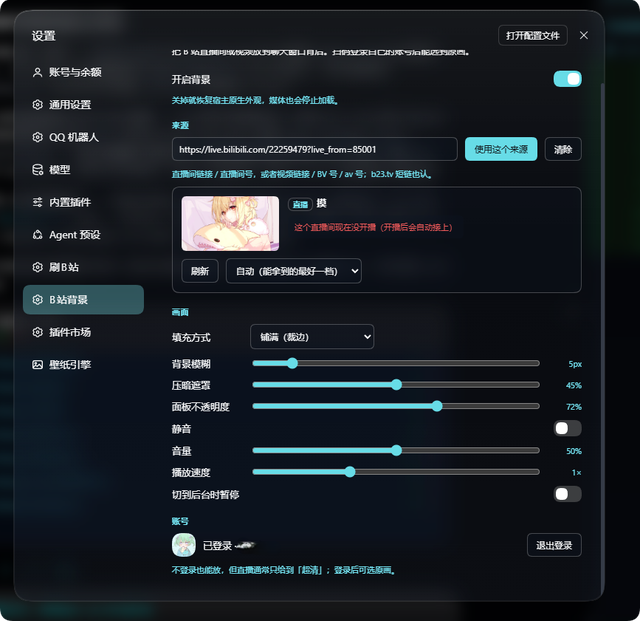
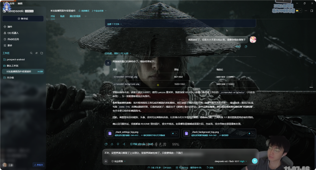

# dsh-bili-wallpaper

把 **B 站直播间实时画面** 或 **任意视频** 当作 DeepSeek Harness Web GUI 的背景。扫码登录你自己的 B 站账号 → 粘一个直播 / 视频地址 → 选清晰度，画面就在聊天窗口背后播放。

> A DeepSeek Harness plugin that plays a Bilibili live room or video behind the chat UI. Scan-login with your own account, paste a live/video link, pick the quality tier — with adjustable blur, scrim and panel opacity.

<p align="center">
  
</p>

---

## 它能做什么

| 能力 | 说明 |
| --- | --- |
| **直播背景** | 输入直播间链接或房号（`https://live.bilibili.com/6` / `6`），实时画面铺在聊天背后 |
| **视频背景** | 输入视频链接、`BV` 号或 `av` 号，循环播放；支持分 P |
| **扫码登录** | 二维码直接画在设置页里，手机 B 站扫一扫即可；登录后直播可选「原画」 |
| **清晰度选择** | 「自动」= 能拿到的最好一档；也可手动指定原画 / 蓝光 / 超清… |
| **画面调节** | 铺满 / 完整、背景模糊、压暗遮罩、面板不透明度、静音 / 音量 / 播放速度 |
| **省电** | 切到后台自动暂停（可关） |
| **半透明 UI** | 前端面板、侧栏、气泡自动变成能透出画面的玻璃面，文字仍可读 |
| **开播自愈** | 直播地址过期或主播下播后重开，会自动重新解析接上 |

### 界面

设置页在 **设置 → B站背景**，五块：开启背景 / 来源 / 清晰度 / 画面 / 账号。

> 📷 **截图待补**：`assets/screenshot-settings.png`（设置页）与 `assets/screenshot-background.png`（背景效果）。
> 补图后把下面这段注释解开即可。

<!--
<p align="center">
  
</p>
<p align="center">
  
</p>
-->

---

## 安装

### 方式一：从 GitHub 装（推荐）

```powershell
# 1. 克隆到任意目录
git clone https://github.com/st21a1/dsh-bili-wallpaper.git
cd dsh-bili-wallpaper

# 2. 装进你的 profile（desktop 是桌面版默认 profile）
dsh plugin --profile desktop add .
```

### 方式二：直接用目录路径装

```powershell
dsh plugin --profile desktop add "C:\path\to\dsh-bili-wallpaper"
```

### 方式三：在 Harness 里让 Agent 装

把仓库地址交给 Agent，说「把这个插件装进当前 profile」即可（它会调用 `plugin_manager install_bundle`）。

### 装完要做的事

1. **重启 Harness**（Host 半端 `index.js` 需要重启才加载）
2. 打开 **设置 → B站背景**
3. 粘一个直播或视频地址，点「使用这个来源」
4. 想拿原画就点「扫码登录」

> 只改 `client.js`（界面部分）时不需要重启，刷新页面即可（走 client HMR）。

### 卸载

```powershell
dsh plugin --profile desktop remove dsh-bili-wallpaper
```

配置和登录凭证在 `$DSH_HOME/bili-wallpaper/`，卸载不会自动删除，需要的话手动删掉。

---

## 支持的 profile

| Profile | 支持 | 说明 |
| --- | --- | --- |
| `desktop` | ✅ 完整 | 桌面版默认 profile，开发和验证都在这里做 |
| `web` | ✅ 完整 | `dsh web` 启动，浏览器访问；背景层是纯 DOM，不依赖 Electron |
| `tui` / headless | ❌ 无意义 | 没有 Web GUI，装了也不会有画面 |

插件声明了硬依赖 `webServer`：没有 HTTP 服务的 profile 不会加载这一行，不会报错也不会拖慢启动。

---

## 权限与数据

**只读你自己的数据，只连 B 站。**

| 项目 | 详情 |
| --- | --- |
| 网络 | 仅访问 `api.bilibili.com`、`api.live.bilibili.com`、`passport.bilibili.com`（登录）、以及 B 站 CDN 取流 |
| 账号凭证 | 扫码后从 `Set-Cookie` 取 `SESSDATA` / `bili_jct` / `DedeUserID` / `buvid3`，存 `$DSH_HOME/bili-wallpaper/bili_credential.json`（尝试 `chmod 600`） |
| 本地配置 | `$DSH_HOME/bili-wallpaper/config.json` |
| 不上传 | 凭证、观看记录、任何数据都不会发到第三方；没有遥测 |
| HTTP 路由 | 仅 `127.0.0.1` 同源；带签名校验 |
| 媒体代理 | 只放行 B 站 CDN 域名白名单，**不是**开放代理 |
| 文件系统 | 只读写上面两个文件，不碰工作区 |
| 子进程 | 无（不调用 ffmpeg / python / 外部二进制） |

### 为什么必须有 Host 端代理

不是选择，是必需：

1. **防盗链**：B 站视频 CDN 不带 `Referer: https://www.bilibili.com/` 直接返回 `403`（实测）。
2. **HLS 清单改写**：m3u8 里的分片是相对路径，浏览器直连既跨域又带不了 Referer。
3. **签名**：每个代理地址带 `HMAC-SHA256(进程内随机密钥, 目标 URL)`，重启即失效。
4. **直播地址时效**：URL 里的 `expires` 一般几十分钟，客户端在 hls.js 报致命错误时会让 Host 重新解析。

---

## 兼容性

| 项 | 版本 |
| --- | --- |
| DeepSeek Harness | `^0.2.0-rc.1`（开发与验证于 **0.2.1-rc.3**） |
| Node.js | `>=22.12.0` |
| 平台 | Windows / macOS / Linux（验证环境：Windows 11 + DSH Desktop） |
| 浏览器 | 支持 `MediaSource Extensions` 的现代浏览器（Chrome / Edge / Firefox / Safari 14+） |
| 与其它插件 | 与 `dsh-plugin-wallpaper-engine` 功能重叠：两个都开时会提示，建议只开一个 |
| 需要 Web GUI | 是（`desktop` / `web` profile） |

### 依赖

运行时依赖已随包 vendor，**不需要联网安装任何 npm 包**：

- [`hls.js`](https://github.com/video-dev/hls.js) 1.6.13（light build）— Apache-2.0
- [`qrcode`](https://github.com/soldair/node-qrcode) 1.5.4 — MIT
- [`dijkstrajs`](https://github.com/tcort/dijkstrajs) 1.0.3 — MIT

---

## 已知限制

- 直播只走 **HLS**（ts / fmp4）。只提供 FLV 的直播间会明确报「暂不支持」，不会黑屏。
- 视频走 `durl`（MP4 整段）；被 B 站切成多段的视频**只循环第一段**，页面上会写明。
- 未登录时视频一般最高 720P、直播一般「超清」；「原画」需要登录。
- 直播以 **ts** 优先：AAC 音轨直接混在分片里，音画天然同步（实测 `Audio: aac (LC), 48000 Hz, stereo`）。
- 浏览器可能拦截带声音的自动播放 → 先静音放起来并在页面提示，点一下即恢复。

---

## 开发

```powershell
node build.mjs               # 把 hls.js 内联进 client.js（改完 client.src.js 必须跑）
node test/test-client.mjs    # 假 window 里跑一遍注册，确认 slot 与 hls 清理
node test/test-hls-inline.mjs# 确认内联的 hls.js 真的挂上 globalThis.Hls
node test/test-audio.mjs     # 声音回归：配置迁移 / 音量兜底 / 直播必须选 ts
node test/test-host.mjs      # 假 ctx 起 Host，真打 B 站接口与代理
```

`test/test-host.mjs` 会用临时 `DSH_HOME`，不碰真实配置和凭证。

### 结构

```
index.js            Host：路由、扫码登录、来源解析、媒体代理、配置存储
client.src.js       浏览器半端源码（含 /*__HLS_INLINE__*/ 占位）
client.js           产物（build.mjs 生成，勿手改）
build.mjs           node build.mjs → 把 hls.js 内联进 client.js
cordis.patch.yml    bundle patch（一行 Host 插件）
locale/{zh,en}.json 插件管理器里显示的名字 / 说明
icon.svg            图标
vendor/             hls.js、qrcode、dijkstrajs（均为宽松许可证）
test/               离线自测
```

### 架构

```
浏览器                          Host（Node）                       B 站
  │  设置页 / 背景层                │                               │
  ├── GET  /api/bili-wallpaper/state ─────► 配置 + 账号快照
  ├── POST /api/bili-wallpaper/config ────► 写 config.json
  ├── POST /api/bili-wallpaper/login/start ─► passport 二维码 ───────►
  ├── POST /api/bili-wallpaper/login/poll ──► 轮询 + 取 SESSDATA
  ├── GET  /api/bili-wallpaper/resolve ────► 解析来源 ──► getRoomPlayInfo / playurl
  └── GET  /api/bili-wallpaper/proxy?u=… ──► 带 Referer 取流 ────────►
```

关键技术点：

- 背景层是挂在 `body` 上的普通元素（`z-index: -2`），遮罩 `z-index: -1` —— **不在 React 树里**，换页不丢。
- 面板靠覆盖宿主声明的令牌（`--dsw-alias-bg-base` / `--dsw-alias-bg-layer-*` / `--dsw-specific-sidebar-fill`）变半透明，不碰第三方插件的私有类名；选择器叠到 `(0,2,1)` 并用 `!important` 压住后置样式表。
- `hls.js` 构建期内联，运行时临时挂 `globalThis.Hls` 用完即删，不与其它插件抢全局。

---

## 许可证

[MIT](LICENSE) © 2026 st21a1

第三方组件许可见 [`NOTICE.md`](NOTICE.md)：hls.js（Apache-2.0）、qrcode（MIT）、dijkstrajs（MIT）。

本插件与哔哩哔哩（bilibili）官方无关，仅通过其公开接口获取内容，供个人本地使用。请遵守 B 站用户协议与相关法律法规，不要用于转载、再分发或商业用途。